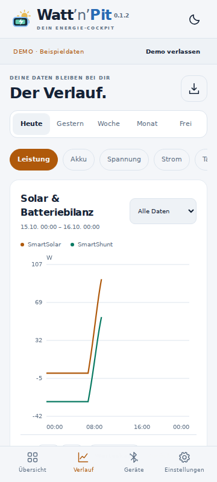

# Watt’n’Pit

**Dein Energie-Cockpit.** Eine lokale Android-App für SmartSolar und SmartShunt: Solar, Akku und Batteriebilanz auf einen Blick, mit übersichtlichem Verlauf.

[APK herunterladen](https://github.com/Tim-Gurke/Watt-n-Pit/releases/latest) · [Einrichtung](#einrichtung) · [CSV-Import](docs/CSV-IMPORT.md) · [Technische Grundlage](docs/ARCHITECTURE.md)

## Version 0.1.2

- SmartSolar 75/15 und SmartShunt 300 A gleichzeitig über Bluetooth-Sofortanzeige.
- Luftige Standardübersicht mit sieben Kacheln; 22 Mess- und Zusatzwerte stehen optional bereit.
- Kacheln hinzufügen, antippen und anpassen, frei verschieben, skalieren und überlappen; getrennte Anordnungen für schmale und breite Ansichten.
- Zahlenwert, Rundinstrument oder kleiner Verlauf mit individuell gespeicherten Einheiten, Farben, Skalen, Schriftgrößen, Hintergrund und Deckkraft.
- Restlaufzeit wahlweise in Stunden, Tagen, Minuten oder Sekunden; W/kW, Wh/kWh und weitere passende Einheiten.
- Je Kachel: aktuell, letzte X Minuten/Stunden/Tage, heute, seit Zurücksetzen oder ein freier Zeitraum; letzter Wert, Durchschnitt, Minimum oder Maximum aus vorhandenen Messdaten.
- Entnommene Kapazität ist als Zusatzwert verfügbar und gehört nicht zur Standardübersicht.
- Solarleistung, Tagesertrag und Ladephase des SmartSolar.
- Aufzeichnung auf dem Telefon, auch bei geschlossener Oberfläche; pausierbar über die Benachrichtigung.
- Verlauf für heute, gestern, Woche, Monat und freie Zeiträume.
- Zoomen und Verschieben der Zeitachse, manuelle oder automatische Werteskala.
- CSV-Import mit überprüfbarer Spaltenzuordnung; vollständiger CSV-Export.
- Eigene Aufzeichnungen haben in der Standardansicht Vorrang vor überlappenden Importwerten.
- Dunkles und helles Farbschema, Hoch- und Querformat.
- Deutlich gekennzeichnete Demo ohne Speicherung erfundener Messwerte.

Kein Konto, keine Cloud, keine Werbung. Die App besitzt **keine Internetberechtigung**. Geräteschlüssel werden mit dem Android Keystore verschlüsselt gespeichert; Messdaten bleiben lokal.

## Ansichten

Die folgenden Ansichten zeigen **erfundene Beispieldaten im Demo-Modus**, keine Messung an einer realen Anlage.

| Dunkle Übersicht | Helle Übersicht |
|---|---|
|  |  |

| Verlauf, dunkel | Verlauf, hell |
|---|---|
|  |  |

## Einrichtung

1. [Aktuelle APK herunterladen](https://github.com/Tim-Gurke/Watt-n-Pit/releases/latest) und auf **Android 8 oder neuer** installieren.
2. Beide Geräte in VictronConnect öffnen, unter **Einstellungen → ⋮ → Produktinfo** die **Sofortanzeige über Bluetooth** einschalten.
3. Unter **Sofortanzeige-Details → Anzeigen** jeweils MAC-Adresse und **32-stelligen Verschlüsselungsschlüssel** übernehmen.
4. In Watt’n’Pit **Geräte → Suche starten** wählen und das gefundene Gerät einrichten, oder es mit **+** manuell hinzufügen.
5. Schlüssel einfügen und Aufzeichnung starten. Die aktive Geräteverbindung in VictronConnect verlassen, damit die Sofortanzeige empfangen wird.

Der Schlüssel ist je Gerät verschieden und **nicht die sechsstellige Bluetooth-PIN**. Die Android-Berechtigung für Geräte in der Nähe ist erforderlich. Auf Android 8–11 benötigt die BLE-Suche außerdem die Standortberechtigung und den aktivierten Standortdienst; Watt’n’Pit zeichnet keinen Standort auf.

## Übersicht gestalten

- **+ Kachel**: Messwert auswählen. Die neue Kachel erscheint am Ende der Übersicht und wird in den sichtbaren Bereich gescrollt.
- **Kachel antippen**: Messwert, Beschriftung, Einheit, Darstellung und Zeitraum ändern. Weitere Optionen stehen unter Farben & Schrift, Skala sowie Größe & Ebene.
- **Anordnen**: Kacheln ziehen und an der unteren rechten Ecke vergrößern. Überlappungen sind erlaubt; andere Kacheln behalten ihre Position. **Fertig** beendet das Anordnen.
- Schmale und breite Ansichten haben eigene Positionen und Größen. Die Einstellungen werden auf diesem Telefon gespeichert und bleiben beim App-Update erhalten.
- Unter **Einstellungen → Standardübersicht wiederherstellen** lässt sich die schlanke Ausgangsansicht zurückholen.

Temperatur und Zusatzspannung benötigen den entsprechend eingerichteten Shunt-Eingang. Die Energie im Akku ist eine rechnerische Näherung aus Ladezustand, Kapazität und momentaner Spannung. Fehlende Werte erscheinen als „—“. Zeitfenster zeigen ausschließlich gespeicherte Messwerte; beim Solar-Tagesertrag werden Zählerstände ausgewertet und keine Tageserträge addiert.

## Solar und Batteriebilanz

Die Solaransicht zeigt die am SmartSolar angeschlossenen Module. Ein mobiles Modul an einem separaten PWM-Regler ist in der **Batteriebilanz des SmartShunts** enthalten, wenn alle Ladegeräte/Verbraucher auf der Anlagenseite des Shunts angeschlossen sind. Ohne eigenen Messwert lässt sich seine einzelne Leistung nicht bestimmen.

Positiver Batteriestrom bedeutet Laden, negativer Batteriestrom Entladen. Restlaufzeit und Ladezustand stammen vom SmartShunt; Watt’n’Pit kalibriert den Shunt nicht und ändert keine Einstellungen des Ladegeräts. Temperatur oder Zusatzspannung erscheinen nur, wenn der entsprechende Shunt-Eingang dafür eingerichtet ist und Werte liefert.

## Stand und offene Aufgaben

0.1.2 ist eine Testversion. Decoder, CSV-Verarbeitung, Android-Lint, APK-Build und die Oberfläche sind automatisiert geprüft. **Die Prüfung an echten Victron-Geräten steht noch aus.**

**Direktes automatisches Nachladen gespeicherter Gerätetrends ist noch nicht implementiert.** Die offene Sofortanzeige überträgt Livewerte und keine archivierten Zeitreihen. Ein belastbar verifizierter Archivzugriff ist für eine spätere Ausbaustufe vorgemerkt. Ziel: Beim nächsten Empfang fehlende Zeitbereiche automatisch holen, eigene Aufzeichnungen priorisieren und unterbrochene Downloads fortsetzen. CSV-Import ist bereits verfügbar. Fehlende Vergangenheit wird nicht aus aktuellen Werten erfunden.

In dieser Version lässt sich je ein SmartSolar und ein SmartShunt einrichten. Eine lang laufende Aufzeichnung kann unter aggressiven Android-Energiespareinstellungen eingeschränkt werden; bei Bedarf die Hintergrundnutzung für Watt’n’Pit erlauben.

## Entwicklung

Voraussetzungen: Java 17 und Android SDK 35.

```sh
./gradlew testDebugUnitTest lintDebug assembleDebug
```

Die APK liegt unter `app/build/outputs/apk/debug/app-debug.apk`. Die öffentlich bereitgestellte Release-APK wird getrennt mit einem dauerhaften privaten Signaturschlüssel signiert. Die Signatur bleibt für spätere Updates erhalten.

Die Einheiten- und Konfigurationstests laufen mit `node --test tools/dashboard-core.test.cjs`.

Für die Oberflächenprüfung: `node tools/ui-smoke.cjs` (Playwright erforderlich; startet einen lokalen Asset-Server selbst). Die App selbst nutzt keine npm-Abhängigkeiten.

MIT-Lizenz. Unabhängiges Projekt, kein offizielles Victron-Produkt.

## Tagesarchiv
Victron SolarHistory.csv wird getrennt von Livewerten gespeichert und im Verlauf als Tageswerttabelle angezeigt. Der automatische Bluetooth-Archivabruf bleibt offen.
