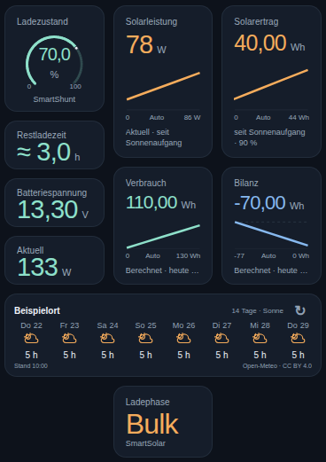
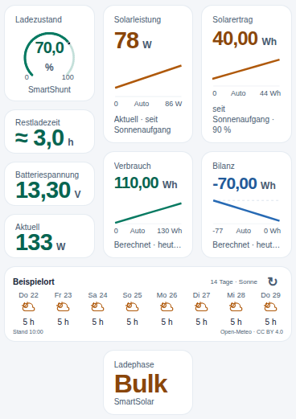
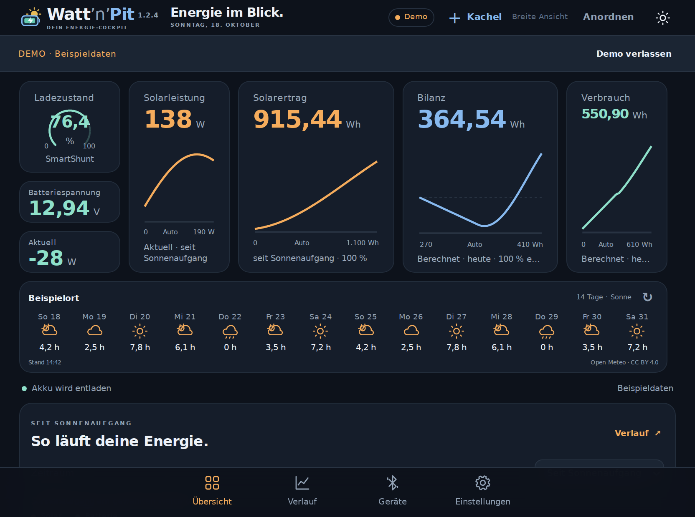
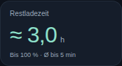
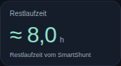
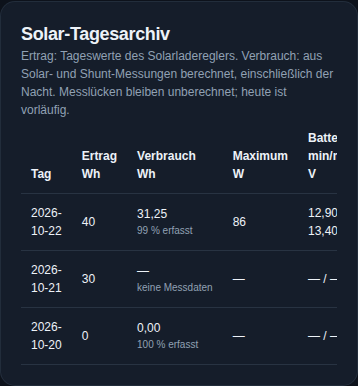
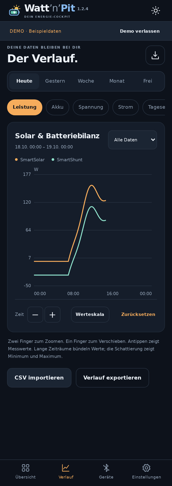
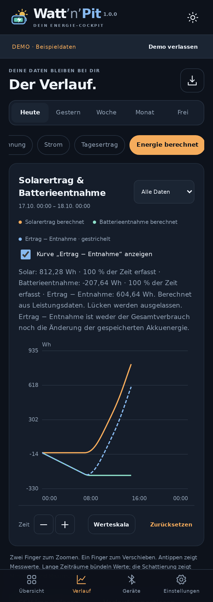
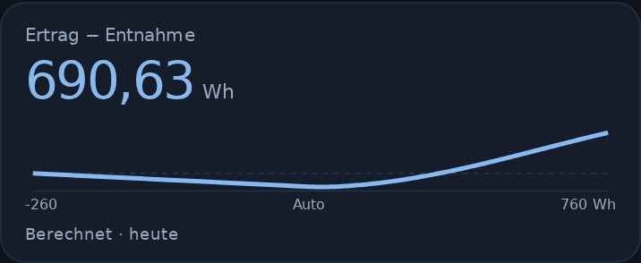

# Watt’n’Pit

**Dein Energie-Cockpit.** Solar, Akku und Batteriebilanz auf einen Blick – direkt über Bluetooth, mit lokaler Aufzeichnung und frei gestaltbarer Übersicht.

**Watt’n’Pit ist eine Energieanzeige und ein Cockpit. Die App ersetzt VictronConnect nicht.** Sie zeigt Messwerte, Verläufe und Energieauswertungen. Einstellungen an Solarregler und SmartShunt müssen weiterhin über die Victron-Software **VictronConnect** vorgenommen werden. Die Einstellungen in Watt’n’Pit betreffen nur die App und ändern keine Geräteparameter.

Auch Firmware-Updates deiner Victron-Geräte führst du weiterhin über die offiziellen Victron-Apps durch, bei SmartShunt und SmartSolar über VictronConnect. Watt’n’Pit kann keine Geräteupdates durchführen.

**[Android-APK 1.5.0 herunterladen](https://github.com/Tim-Gurke/Watt-n-Pit/releases/download/v1.5.0/Watt-n-Pit-v1.5.0.apk)** · [Release](https://github.com/Tim-Gurke/Watt-n-Pit/releases/latest) · **[Anleitung mit Screenshots](docs/ANLEITUNG.md)** · [CSV-Import](docs/CSV-IMPORT.md)

Android 8 oder neuer · Kein Konto · Keine Werbung · Unabhängiges Projekt, kein offizielles Victron-Produkt.

## Neu in 1.5.0

**Rollerladung und Fahrreserve planen:** JBD/Overkill-BMS direkt lesen oder BMS-Grunddaten lokal aus kompatiblem ScootPit übernehmen. Ladeenergie am Roller aufzeichnen, Wohnwagenbedarf mit einem einstellbaren, vorläufigen Verlustprofil schätzen und den verbleibenden Ladebedarf in die Akkuprognose einrechnen. Die BMS-Kopplung setzt ScootPit mit Schnittstelle aus 1.6.13-test.1 oder neuer auf demselben Telefon voraus; diese Veröffentlichung betrifft Watt’n’Pit.

**Weniger Scrollen, mehr Übersicht:** Die Bearbeitung hält ihre Scrollposition. Der Rollerbereich lässt sich unter „Anordnen“ nach oben setzen und für beide Ansichten skalieren. Gerätearchive werden standardmäßig im Hintergrund ergänzt; oben lassen sich Details und Abbrechen öffnen. Herunterziehen am oberen Rand der Übersicht startet ebenfalls das Nachladen. „Standardübersicht wiederherstellen“ setzt das ganze Dashboard einschließlich Kachelgrößen und Positionen zurück.

Die Archivzeit- und Lernkorrekturen aus den 1.4.7-Tests sind enthalten. Lücken, geschätzte Beiträge und noch vorläufige Lernabschnitte bleiben erkennbar. [Alle Änderungen und Grenzen](docs/releases/1.5.0.md).

## Neu in 1.4.6

Die Solarvorschau bezeichnet die obere Wh-Spanne ausdrücklich als **Gesamtpotenzial aller aktiven Kreise**. Feste Kreise und mobile Entlastung stehen getrennt darunter. Die gemessene Solarertrag-Kachel enthält weiterhin nur die Solarregler. Die Energie- und Prognoseformeln bleiben unverändert; die angegebene Spanne ist kein garantierter Mindestertrag.

Nach Sonnenuntergang bleibt der heutige Akkubalken mit einem passenden gespeicherten SmartShunt-Wert sichtbar. Die Tagesansicht nennt seine Messzeit und Quelle. Es wird ausschließlich ein Originalwert mit höchstens 15 Minuten Abstand verwendet; ohne passenden Wert erklärt die App die fehlende Grundlage. Die Reserve am nächsten Sonnenaufgang bleibt eine Prognose.

**Einstellungen → Akku & Aufzeichnung → Betriebsbenachrichtigung einstellen** öffnet die Android-Einstellung für „Watt’n’Pit-Aufzeichnung“. Dort lässt sich die dauerhafte Anzeige ausblenden, während Empfang und Aufzeichnung weiterlaufen. Der Archivkanal ist getrennt. Sonnen hinter Wolken werden in beiden Designs sauber verdeckt; Firmware- und Projekthinweise sind ergänzt.

## Neu in 1.4.5

Ein Victron-Kennwert für **nicht verfügbaren Shunt-Strom** wurde bisher als sehr hoher Ladestrom verarbeitet und konnte einen plötzlichen Absturz im Verbrauchsverlauf erzeugen. Der Decoder erkennt diesen Kennwert jetzt korrekt. **Beim ersten Start nach dem Update werden bereits gespeicherte Fehlwerte automatisch bereinigt.** Alle übrigen Messwerte, Zeitpunkte, Archive und Einstellungen bleiben erhalten; Zurücksetzen und erneutes Synchronisieren sind dafür nicht nötig. Auch alte CSV-Sicherungen werden beim Import geschützt. Die Energieformel bleibt unverändert.

## Neu in 1.4.4

Das Verbrauchslernen nutzt geeignete **Messabschnitte mit und ohne mobiles Modul**. Ein fehlender Tagesabschnitt verwirft nicht mehr den ganzen Tag. Nachtdaten bleiben bei „Mobil an“ nutzbar; geeignete Tagesabschnitte ergänzen einen klar als Schätzung behandelten mobilen Beitrag. Fehlende Tageszeiten werden zunächst vorsichtig hochgerechnet. Jahreszeit und bisherige Erfahrung bleiben berücksichtigt.

Beim Geräteabruf liest Watt’n’Pit zusätzlich die verfügbaren **aktiven Ladeeinstellungen aus SmartShunt und SmartSolar**. Unter einem Vorschautag erklärt **Aktive Ladeeinstellungen und Begrenzung**, welche Werte zuletzt gelesen wurden. Schonladeprofile, Stromgrenzen und unklare Ladephasen dürfen die Solarerfahrung nicht nach unten verfälschen. Angezeigte 100 % allein beweisen keine Abregelung. Entgangene Wh bleiben eine Schätzung; Watt’n’Pit ändert keine Geräteparameter.

## Neu in 1.4.3

Die abgestimmte Startvorlage hat eine höhere Solarvorschau und die Ladephase direkt darunter. Kacheln, Farben, Werte, Zeiträume und beide Ausrichtungen entsprechen der neuen Vorlage; neue Installationen starten beim Übersichtsverlauf mit **Heute**. Eigene gespeicherte Übersichten und Zeitraumauswahlen bleiben erhalten. Über **Standardübersicht wiederherstellen** ist die neue Kachelanordnung abrufbar.

Die Tagesfelder der Solarvorschau passen sich der verfügbaren Breite an. Auf üblichen Handybreiten passen drei vollständige Tage einschließlich aller Prozentwerte hinein. Die Sonnen-Prozentwerte sind relative Einstrahlung; die Akku-Prozentwerte beschreiben die erwartete Reserve bei Sonnenuntergang. Fehlt diese, steht der Grund direkt unter der Vorschau und lässt sich für die ausführliche Erklärung antippen.

## Neu in 1.4.2

Die Solarvorschau bekommt größere Symbole und Balken. **Sonne** zeigt weiterhin die relative Einstrahlung; **Akku** zeigt auf einer festen Skala von 0 bis 100 % die geschätzte Reserve **bei Sonnenuntergang am Wetterort**. Ein Tag öffnet zusätzlich den erwarteten Akkustand **bei Sonnenaufgang am Folgetag**, jeweils mit Schätzbereich. Die Berechnung beginnt mit dem aktuellen SmartShunt-Ladezustand und berücksichtigt saisonalen Verbrauch und aktive Solarkreise stundenweise. Ein voller Akku speichert höchstens 100 %; möglicher Überschuss wird nicht in die Nacht übertragen. Fehlende Grundlagen erscheinen als **—** mit einer Erklärung. Vorhandene Kachelgrößen und Anordnungen bleiben erhalten.

## So sieht es aus

Die Screenshots zeigen die Bedienoberfläche mit frei erfundenen Beispieldaten. Die zusätzlichen Bedienelemente aus 1.3.10 sind weiter unten abgebildet. Wetterort und Gerätekennungen sind neutral; private Messungen und Verbindungscodes werden nicht veröffentlicht.

| Dunkles Design | Helles Design |
|---|---|
|  |  |

*Die neue Hochkant-Standardansicht ist dreispaltig: links Ladezustand, automatische Akkuzeit, Spannung und aktuelle Batteriebilanz; daneben Solarleistung und Verbrauch; rechts Solarertrag und Bilanz. Darunter folgen Wetter und Ladephase. Werte, Farben, Größen und Positionen bleiben frei einstellbar.*

Solarleistung und Solarertrag beginnen standardmäßig **seit Sonnenaufgang**; Verbrauch und Bilanz zählen **ab Mitternacht**, einschließlich des nächtlichen Verbrauchs. Alle vier Verlaufskacheln verwenden automatische Skalen. Neue Installationen und „Standardübersicht wiederherstellen“ erhalten diese Anordnung; beim Update bleiben gespeicherte eigene Übersichten erhalten.

Die Hochkant-Vorlage enthält zehn Kacheln und eine Verlaufshöhe von 465 Pixeln. Im Querformat stehen Appname, Überschrift, Zustand, **+ Kachel**, Ansichtsart und **Anordnen** gemeinsam im flachen Kopf. Das Raster ist in beiden Formaten doppelt so fein. Die Restlaufzeit bleibt unter **+ Kachel → Akku → Restlaufzeit** verfügbar.



## Das kann 1.3.12

- **Restladezeit und Restlaufzeit automatisch:** Die bisherige Restladezeit-Kachel wechselt beim Laden zur Schätzung bis 100 % und beim Entladen zur Restlaufzeit vom SmartShunt. Titel und Zeit wechseln gemeinsam; bestehende Kacheln erhalten die Automatik direkt mit dem Update. Der Netto-Stromtrend wird über bis zu eine Minute gemittelt und ein Wechsel mit 30 Sekunden frischen Messwerten bestätigt. Bei ausgeglichener Bilanz oder fehlenden Werten steht „—“. Stunden, Minuten, Tage und Sekunden sind wählbar.
- **Neue Hochkant-Vorlage:** Zehn Kacheln, kompaktere Größen, automatische Akkuzeit und Ladephase sowie 465 Pixel Verlaufshöhe. Vorhandene eigene Anordnungen bleiben gespeichert; neue Installationen oder **Standardübersicht wiederherstellen** verwenden die neue Vorlage.

| Beim Laden | Beim Entladen |
|---|---|
|  |  |

- **Daten nachladen:** Neben dem kompakten Play-/Pauseknopf steht auf der Übersicht ein eigener Nachladeknopf. Er prüft beide eingerichteten Geräte und ergänzt fehlende Archivwerte auch direkt nach einem abgebrochenen Abruf. Bereits gespeicherte Werte bleiben erhalten.
- **Abbruch bestätigen:** Ein Tipp auf „Synchronisation abbrechen“ öffnet zuerst eine Bestätigung. „Weiter synchronisieren“ ist die sichere Vorauswahl; erst „Abbruch bestätigen“ beendet den Abruf.
- **Verbrauch im Tagesarchiv:** Neben dem Solar-Tagesertrag erscheint der aus Solar- und Shunt-Messungen berechnete Verbrauch in Wh samt zeitlicher Abdeckung. Fehlende Messdaten erscheinen als „—“, gemessener Nullverbrauch als 0,00. Die Berechnung läuft im Hintergrund und verwendet dieselbe Energieformel wie der Verlauf.




- **Victron-Archivabgleich:** Gerundete Gerätezeiten und normale Enden der Archivstufen werden verarbeitet. Beide Bluetooth-Datenkanäle erhalten passende Empfangsfreigaben; doppelte Cursor-Abfragen entfallen. Bereits gespeicherte Archivstufen behalten ihr tatsächliches Alter. Die reguläre Version übernimmt die App-Logik aus 1.3.9-test.1. [Nachweis mit aufgezeichneten Antworten und Grenzen](docs/diagnostics/victron-sync-1.3.9-test.1.md).

- **Verlauf auf der Übersicht:** „So läuft deine Energie.“ bietet zusätzlich Gestern, Woche (7 Kalendertage), Monat (30 Kalendertage) und die letzten 24 Stunden. Die Auswahl bleibt gespeichert. Unter **Anordnen** lässt sich die Kachel am ↕-Griff in der Höhe ändern; schmale und breite Ansicht speichern ihre Höhe unabhängig. Zeitraumwahl liest lokale Messwerte und startet keinen Bluetooth-Import.

- **Direkter Empfang:** SmartSolar und SmartShunt liefern Livewerte über die Bluetooth-Sofortanzeige. Messdaten und Geräteschlüssel bleiben auf dem Telefon.
- **Synchronisation sichtbar:** Eine Warteanzeige nennt Gerät, Arbeitsschritt und bekannten Fortschritt. **Im Hintergrund synchronisieren** gibt die Bedienung für den aktuellen Durchlauf frei; eine kleine Statusanzeige bleibt erreichbar. **Synchronisation abbrechen** bleibt verfügbar. Die Auswahl gilt für die gesamte Gerätewarteschlange und wird anschließend verworfen. Bereits gespeicherte Daten bleiben erhalten.
- **Einmaliger Cockpit-Hinweis:** Den seit 1.2.5 enthaltenen Hinweis einmal mit **Verstanden** bestätigen; eine vorhandene Bestätigung bleibt erhalten. Watt’n’Pit ersetzt VictronConnect nicht; Geräteeinstellungen bleiben dort.
- **Tatsächliche Abdeckung:** Archivabgleich, Speicherung, Energieberechnung und Kurven berücksichtigen zusammenhängende Messabschnitte. Ein naher Livepunkt allein erklärt einen fehlenden Archivabschnitt nicht für vollständig. Quellenwechsel und der Übergang auf eine andere Archivauflösung erzeugen keine künstlichen Unterbrechungen; echte Ausfälle bleiben sichtbar.
- **Seltener verbinden:** Erfolgreich abgeglichene Geräte werden nicht im Fünf-Minuten-Takt neu verbunden. Reine neue Archivmessgrößen werden beim nächsten Vordergrundabgleich gesammelt ergänzt. Vor einer automatischen Archivverbindung wird der lokale Bedarf geprüft. Sind die neuen Zeitbereiche durch die Aufzeichnung gedeckt, entfällt die Verbindung. Die bereits gelesene Archivaufteilung bleibt pro Gerät gespeichert; der erste Aufbau dieses Plans benötigt einmalig einen Geräteabgleich.
- **Gezielt ergänzen:** Erst wird pro Gerät und Messgröße der Nachladebedarf bestimmt, anschließend werden die fehlenden Bereiche samt nötigen Randpunkten angefordert. Zusammenhängende Hintergrundaufzeichnung zählt mit. Nach einem Abbruch wird nur der verbleibende Bedarf ergänzt. Automatische und manuelle Abrufe haben kein festes Gesamtzeitlimit; einzelne unbeantwortete Bluetooth-Aufträge bleiben begrenzt. Nach einem erfolgreichen Abgleich beginnt während derselben geöffneten Sitzung kein neuer automatischer Archivlauf. Offene fehlgeschlagene Abrufe werden erst nach Empfangsrückkehr oder beim erneuten Öffnen geprüft; die Fehler-Wartefrist beträgt fünf Minuten. Abbrechen pausiert automatische Abrufe 30 Minuten.
- **Erhalt vorhandener Daten:** Das Update bewahrt alle bisherigen Messwerte und Einstellungen. Archivauflösungen werden auch am selben Zeitpunkt getrennt erhalten. Vorhandene Bestätigungen bleiben auch kurz nach dem Empfang gültig. Messwerte und Fortschritt werden gemeinsam gespeichert; bestätigte Antworten ohne Messwert lösen keinen wiederholten Abruf derselben Punkte aus.
- **Eigene Übersicht:** Kacheln hinzufügen, ziehen, vergrößern und überlappen. Zahlen, Rundinstrumente oder Verlauf wählen; Einheiten, Farben, Schrift und Zeiträume anpassen. Schmale und breite Ansichten haben eigene Anordnungen.
- **Großansicht:** Kachel antippen und **Großansicht öffnen** wählen. Zeitraum, Einheiten und Skala untersuchen, zoomen und weitere Messgrößen zum Vergleich einblenden. Ein Messpunkt wird durch Punkt und senkrechte Linie markiert. Die Auswahl lässt sich mit dem Finger ziehen; Uhrzeit und Werte folgen. **Auswahl aufheben** gibt das Verschieben des Zeitraums frei. Änderungen in dieser Ansicht sind vorübergehend; **Kachel-Einstellungen** speichert die gewünschte Kacheldarstellung.
- **Solarfenster:** Solarleistung und Solarertrag enden nach Sonnenuntergang regulär dort. Gemessene Erzeugung vor Sonnenaufgang oder nach Sonnenuntergang erweitert das Fenster und zählt mit. Der Wh-Ertrag bleibt sichtbar; Verbrauch und Bilanz zählen den ganzen Tag.
- **Erkennbare Kurven:** Optionale automatische Skalen folgen den bisherigen Messwerten. Die große Livezahl bleibt vom Kurvenzeitraum unabhängig; „Seit Sonnenaufgang“ ist je Kachel wählbar.
- **Drei Energiewerte:** Solarertrag, berechneter Verbrauch und die Differenz **Ertrag − Verbrauch** in Wh/kWh. Direkt genutzter Solarstrom ist im berechneten Verbrauch enthalten. Plus bei der Bilanz bedeutet Überschuss, Minus Defizit.
- **Passende Messabschnitte:** Nach Sonnenaufgang verwenden alle drei Werte nur gemeinsam beobachtete Regler- und Shuntabschnitte. Der nächtliche Verbrauch bleibt über den Shunt enthalten. Messlücken und zeitliche Abdeckung bleiben sichtbar.
- **Bestehende Übersicht übernehmen:** Die Batterieentnahme-Kachel wird beim Update zu „Verbrauch“, die bisherige Akkubilanz zu „Bilanz“. Position, Größe, Farben und Einheiten bleiben erhalten. Die reine Batterieentnahme und die vom Solarregler unabhängige Akkubilanz stehen weiterhin als Zusatzkacheln bereit.
- **Kompaktes Wetter:** 14 Tage mit je einem Symbol und erwarteten Sonnenstunden, seitlich wischbar. Die Wetterkachel lässt sich zwischen den Messkacheln anordnen. Bei aktiviertem Wetter wird die Vorhersage beim Öffnen und bei der Rückkehr aus dem Hintergrund automatisch aktualisiert; gespeicherte Werte bleiben bis dahin sichtbar.
- **Passend zum Setup:** Solarkreise mit Modulanzahl, Nennleistung, Montage, Regler und Messwertquelle hinterlegen. Sechs Farbdesigns, jeweils hell und dunkel.
- **Sichern und übertragen:** Einstellungen samt Anordnungen und Wetterort als JSON exportieren und mit Vorschau importieren. Messdaten getrennt als CSV sichern oder einlesen.



*Heute, gestern, Woche, Monat oder freien Zeitraum wählen. Quellen filtern, Kurven zoomen, Achsen anpassen und einzelne Messwerte antippen.*

## In fünf Schritten starten

Beim ersten Öffnen den Cockpit-Hinweis lesen und **Verstanden** wählen. Er erscheint auch bei bestehenden Installationen einmal nach diesem Update. Die Bestätigung bleibt nur auf diesem Gerät und wird nicht mit Einstellungen exportiert.

1. Die [APK herunterladen](https://github.com/Tim-Gurke/Watt-n-Pit/releases/download/v1.5.0/Watt-n-Pit-v1.5.0.apk) und installieren. Für Updates die neue APK über die bestehende Installation installieren.
2. In **VictronConnect → Einstellungen → ⋮ → Produktinfo** die **Sofortanzeige über Bluetooth** des jeweiligen Geräts einschalten.
3. Unter **Sofortanzeige-Details → Anzeigen** die Geräteadresse und den **32-stelligen Verschlüsselungsschlüssel** übernehmen.
4. In Watt’n’Pit unter **Geräte → Suche starten** das Gerät einrichten oder mit **+** manuell hinzufügen. Jeder Geräteschlüssel gehört zu genau einem Gerät.
5. Die aktive Verbindung in VictronConnect trennen, die Aufzeichnung starten und in Reichweite bleiben. Gerätearchive werden automatisch ergänzt. Auf der Übersicht startet **Daten nachladen** einen manuellen Abgleich beider Geräte; unter **Geräte** bleibt der Abruf einzelner Geräte verfügbar.

Die sechsstellige Bluetooth-PIN für die Android-Kopplung ist **ein anderer Code** als der Schlüssel der Sofortanzeige. Bestehende Kopplungen brauchen keine neue PIN-Abfrage. Auf Android 8–11 benötigt die BLE-Suche Standortberechtigung und eingeschalteten Standortdienst; Die optionale Solarplanung übernimmt einen Standort nur auf ausdrücklichen Wunsch.

**[Die vollständige Anleitung](docs/ANLEITUNG.md)** erklärt Einrichtung, Import, Anordnung, Sonnenaufgang, Skalen, Wetter, Solaranlage und Einstellungssicherung mit Screenshots.

## Was die Werte bedeuten

**Batteriebilanz und Batteriestrom:** positiv bedeutet Laden, negativ Entladen. Ladezustand und Restlaufzeit stammen vom SmartShunt. Fehlende oder veraltete Livewerte erscheinen als „—“.

**Solarertrag:** Aus erfasster Leistung des Solarreglers berechnet, im Standard seit Sonnenaufgang am Wetterort. Ein ungemessener zusätzlicher Regler ist darin nicht enthalten. Ohne gültigen Sonnenaufgang erscheint ausdrücklich „heute (Ersatz)“.

**Verbrauch:** Rechnerisch **Solarertrag − Akkubilanz**. Dazu gehören direkt genutzter Solarstrom und Energie aus dem Akku. Im Standard zählt er ab Mitternacht; außerhalb des Solarfensters wird der beobachtete Shunt-Verlauf verwendet. Tatsächlich erfasste Erzeugung vor Sonnenaufgang oder nach Sonnenuntergang erweitert das Solarfenster. Darin müssen Regler und Shunt für denselben Abschnitt vorliegen. Der Wert ist eine Näherung aus den Messstellen einschließlich der Verluste dazwischen.

**Bilanz:** **Solarertrag − Verbrauch**. Beispiel: **100 Wh Ertrag − 150 Wh Verbrauch = −50 Wh Defizit**. Die Bilanz entspricht im reinen Solarbetrieb dem erfassten Nettofluss am Akku; Ladeverluste werden nicht herausgerechnet. Sie beschreibt keine genaue Änderung des chemischen Akkuinhalts.



**Zusätzlicher PWM-Regler oder andere ungemessene Einspeisung:** Der fehlende Ertrag senkt den berechneten Verbrauch um denselben Betrag. Beispiel: 20 Wh gemessener Solarertrag + 30 Wh ungemessener PWM-Ertrag und 100 Wh tatsächlicher Verbrauch erscheinen als **20 Wh Ertrag, 70 Wh Verbrauch und −50 Wh Bilanz**. Im reinen Solarbetrieb bleibt die Differenz erhalten. Bei starker zusätzlicher Einspeisung kann der berechnete Verbrauch negativ werden; die App zeigt dann „Zusätzliche Einspeisung“. Alle Batteriezweige müssen korrekt über den Shunt erfasst werden.

Messlücken werden ausgelassen, nicht mit Tageswerten aufgefüllt. Die Prozentangabe nennt die erfasste Zeit des jeweiligen Fensters. Ohne verwertbare Messintervalle erscheint „—“, gemessene Null bleibt 0 Wh. Vor Sonnenaufgang steht der Solarertrag ohne erfasste frühere Erzeugung bei 0 Wh. Nach Sonnenuntergang endet die Solarzeitachse am Sonnenuntergang oder an der letzten verwertbaren späten Erzeugung; der Tagesertrag bleibt stehen.



Verbrauch und Bilanz verwenden einen gemeinsamen Zeitraum. Bei „Heute“ darf der Solarertrag seit Sonnenaufgang zählen; bei anderen Zeiträumen wechseln die drei Energiewerte gemeinsam. Einstellungen einer Großansicht verändern die Übersicht weiterhin nicht. Die Zusatzkacheln **Batterieentnahme berechnet** und **Akkubilanz** lassen sich unabhängig einstellen.

## Solarvorschau und Energieplanung ab 1.4.0

Die vorhandene Wetterkachel zeigt jetzt eine **Solarvorschau für 14 Tage** mit Sonnenstunden, einem sonnenbezogenen Symbol und Strahlungsbalken. Mit hinterlegten Solarkreisen, Montagewinkeln und aktueller Ausrichtung kommt eine geschätzte Wh-Spanne dazu. Ein Tag öffnet die Aufteilung in morgens, mittags und abends sowie den Vergleich zum üblichen Verbrauch. Weiter entfernte Tage sind eine grobe Tendenz.

**Einstellungen → Deine Solaranlage** speichert den Montagewinkel je Kreis. **Aufstellung ändern** übernimmt den gemeinsamen Standort über Ortssuche oder einen freiwilligen einmaligen GPS-Abruf; je Kreis wählst du eine von 16 Richtungen und geschätzten Schatten. Der Handykompass unterstützt die Bestimmung draußen vor dem Modul oder drinnen zur Montagewand. Die Richtung wird erst nach ausdrücklichem Übernehmen und Speichern verwendet.

Mobile Module sind standardmäßig aus. Der Schalter **Mobil an/aus** meldet die tatsächliche Aufstellung; nach einem Standortwechsel sind sie wieder aus. Ein ungemessener PWM-Kreis zählt ausschließlich als **geschätzte Verbrauchsentlastung**. Die bisherige Messformel bleibt erhalten, der PWM-Beitrag wird darin nicht ein zweites Mal abgezogen.

Der Verbrauch lernt ohne vorherige Eingaben aus geeigneten Messabschnitten, auch bei mobiler Aufstellung. Jahreszeit und Tagesabschnitte gehen mit gleitenden Übergängen ein; eigene saisonale Wh-Werte sind freiwillig. Ohne ausreichende Daten erscheint **Wird ermittelt** oder eine vorläufige Schätzung. Gespeicherte ursprüngliche Vorhersagen werden erst nach mehreren vergleichbaren Tagen vorsichtig an passende Messwerte angepasst. Messlücken, gemeldete Zusatzladung und erkennbare Abregelung sind keine gültigen Lernbeispiele. Lernstände bleiben auf diesem Telefon; mehrere Handys gleichen sie nicht automatisch ab.

**1.4.1 korrigiert die Zuordnung der Wettertage über die Zeitumstellung.** Der 25. Oktober erscheint einmal und wird als 25-Stunden-Tag berechnet. Fehlende Anlagenangaben und fehlende Wetterdaten erhalten getrennte Hinweise.

[Bedienung und Grenzen](docs/ANLEITUNG.md#7-solarvorschau-und-solaranlage-einstellen) · [Version 1.4.0](docs/releases/1.4.0.md)

## Lokal und mit optionalem Wetter

Aufzeichnung, Gerätearchive und CSV-Daten werden lokal zusammengeführt. Geräteschlüssel werden mit dem Android Keystore verschlüsselt gespeichert. Die Einstellungssicherung enthält **keine Geräteadressen, PINs, Schlüssel oder Messdaten**; ihr Wetterort ist Bestandteil der Konfiguration.

Nur die optionale Ortssuche und Wettervorschau nutzen Internet: Suchtext bzw. Ortskoordinaten sowie Montagewinkel und Ausrichtung gehen per HTTPS an Open-Meteo. Wetterdaten: Open-Meteo, CC BY 4.0; Ortsdaten: GeoNames. Es werden keine Energiedaten oder Geräteschlüssel übertragen.

## Kompatibilität und Stand

SmartSolar 75/15 mit Bluetooth und SmartShunt 300 A wurden an realer Hardware erprobt. Der vollständige Archivimport und die Verlaufsanzeige sind seit 0.1.5 bestätigt; Übersicht und kompakte Wetterkachel wurden bis 0.1.9 ebenfalls am Android-Gerät bestätigt. Die Anordnungen und die Großansicht werden zusätzlich automatisiert geprüft. Der Wetterabruf beim Öffnen ist seit 1.2.2 enthalten. Weitere Victron-Geräte sind **nicht pauschal als kompatibel bestätigt**. In dieser Version lässt sich je ein SmartSolar und ein SmartShunt einrichten.

Es bleiben immer die **drei neuesten Releases mit APK-Downloads** verfügbar.

Die App ändert keine Ladeparameter und löscht keine Gerätetrends. Temperatur und Zusatzspannung benötigen einen entsprechend eingerichteten Geräteeingang. Eine lang laufende Aufzeichnung kann durch Android-Energiespareinstellungen begrenzt werden.

Automatisierte Prüfung: **182 JVM-Tests und 101 Node-Tests**, zusätzliche SQLite-/Speicher-/Neustartprüfungen mit aufgezeichneten Victron-Antworten sowie 12 Vordergrundprüfungen, Android-Lint und Android-Build sowie Browserprüfungen für Bedienung, Speicherung, Importabgleich, Sonnenaufgang, Skalen, Energiekurven und Farbdesigns. Die Energieberechnung prüft zusätzlich direkten Solarverbrauch, Laden/Entladen, nicht gemessenen PWM-Ertrag, Nachtverbrauch trotz Sonnenaufgangsfenster, gemeinsame Messabdeckung, Messlücken und Quellenüberlappung. Browserprüfungen decken die Umstellung bestehender Kacheln, Zeitraumwahl, Einheiten und Einstellungsexport/-import ab. Die bisherigen Browserprüfungen testen zusätzlich asynchrone Abfragen während des Imports, die Wahl pro Abruf, Wiederöffnen, Gerätewechsel sowie die verschiebbare Kurvenmarkierung, sichtbare Warteanzeige, Abbruch und Erhalt offener Eingaben. Die neuen Synchronisationstests prüfen außerdem ältere Lücken, teilweise vorhandene Pakete, Livewerte, Auflösungen, unabhängige App-Installationen und Geräte, Wiederaufnahme und Neustart-Zeitanker. Die tatsächliche Dauer des Bluetooth-Abrufs und die Android-Dateiauswahl sind zusätzlich am Telefon zu bestätigen. [Versionshinweise](docs/releases/1.4.1.md) · [Technische Grundlage](docs/ARCHITECTURE.md)

## Entwicklung

Java 17 und Android SDK 35:

```sh
./gradlew testDebugUnitTest lintDebug assembleDebug
node --test tools/dashboard-core.test.cjs tools/equipment-core.test.cjs tools/settings-backup.test.cjs tools/tile-detail.test.cjs tools/read-bridge.test.cjs tools/solar-core.test.cjs
```

Die Debug-APK liegt unter `app/build/outputs/apk/debug/app-debug.apk`. Öffentliche APKs werden mit einem dauerhaften privaten Schlüssel signiert, damit spätere Updates kompatibel bleiben. Die App verwendet keine npm-Abhängigkeiten.

Dokumentationsbilder lassen sich mit Playwright über `node tools/docs-screenshots.cjs` reproduzieren. Dabei werden ausschließlich erfundene Beispieldaten verwendet. Weitere Browserprüfungen stehen unter `tools/`.

MIT-Lizenz.

© 2026 Tim Weißbach und Mitwirkende · Watt’n’Pit

Die bestehende [MIT-Lizenz](LICENSE) und die zugehörigen Copyright- und Drittanbieterhinweise bleiben erhalten.
