# Watt’n’Pit bedienen

Für Version **1.3.10** · [APK herunterladen](https://github.com/Tim-Gurke/Watt-n-Pit/releases/download/v1.3.10/Watt-n-Pit-v1.3.10.apk) · [Zur Projektübersicht](../README.md)

Watt’n’Pit zeigt Solarleistung, Batteriezustand und gespeicherte Verläufe direkt auf deinem Android-Telefon. Die folgenden Screenshots stammen aus der App-Oberfläche mit **frei erfundenen Beispieldaten**. Wetterort und Gerätekennungen sind Beispiele; es sind keine privaten Verbindungsdaten enthalten. Eine sichtbare Demo liest keine Bluetooth-Geräte aus.

**Watt’n’Pit ist eine Energieanzeige und ein Cockpit. Die App ersetzt VictronConnect nicht.** Sie zeigt Messwerte, Verläufe und Energieauswertungen. Einstellungen an Solarregler und SmartShunt müssen weiterhin über die Victron-Software **VictronConnect** vorgenommen werden. Die Einstellungen in Watt’n’Pit betreffen nur die App und ändern keine Geräteparameter.

## 1. Installieren und Geräte einrichten

1. Die APK herunterladen und auf **Android 8 oder neuer** installieren. Beim Update die bestehende App behalten und die neue APK darüber installieren.
2. In **VictronConnect** den SmartSolar bzw. SmartShunt öffnen. Unter **Einstellungen → ⋮ → Produktinfo** die **Sofortanzeige über Bluetooth** aktivieren.
3. Bei **Sofortanzeige-Details → Anzeigen** die Geräteadresse und den **32-stelligen Verschlüsselungsschlüssel** übernehmen. Jeder Schlüssel gehört zu genau einem Gerät.
4. In Watt’n’Pit **Geräte → Suche starten** wählen. Das gefundene Gerät einrichten oder über **+** manuell hinzufügen. Gerätetyp, Name, Adresse und Schlüssel eintragen und speichern.
5. Die aktive Verbindung in VictronConnect trennen und in Watt’n’Pit die Aufzeichnung starten. In Reichweite der Geräte bleiben.

Beim ersten Öffnen erscheint der Hinweis **Dein Energie-Cockpit**. Mit **Verstanden** bestätigen. Bei bestehenden Installationen erscheint der seit 1.2.5 enthaltene Hinweis nur, solange er noch nicht bestätigt wurde; anschließend bleibt er bei unverändertem Text bestätigt. Ein Schließen ohne Bestätigung zählt nicht. Die Bestätigung wird nur auf diesem Gerät gespeichert und nicht mit Einstellungen übertragen. Der Hinweis bleibt auch unter **Geräte** und **Einstellungen** nachlesbar.

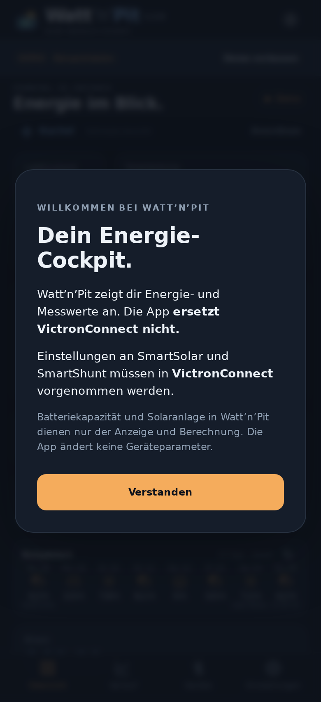

Die sechsstellige **Bluetooth-PIN** wird für die Android-Kopplung verwendet. Sie ist ein anderer Code als der 32-stellige Schlüssel der Sofortanzeige. Eine bereits vorhandene Android-Kopplung benötigt keine erneute PIN-Abfrage.

Die Berechtigung für **Geräte in der Nähe** erlauben. Auf Android 8–11 sind für die Gerätesuche außerdem Standortberechtigung und eingeschalteter Standortdienst nötig. Watt’n’Pit zeichnet keinen Standort auf.

## 2. Gerätearchive automatisch ergänzen

Auf der Übersicht stehen **Play/Pause** und **Daten nachladen** in derselben Zeile. Der kleine Playknopf steuert die laufende Aufzeichnung. **Daten nachladen** gleicht die Archive beider eingerichteten Geräte ab und ergänzt die fehlenden Messgrößen und Zeitabschnitte. Dieser ausdrücklich gestartete Abruf ist auch während der automatischen Wartezeit nach einem Abbruch möglich, sobald der vorige Lauf beendet ist. Unter **Geräte → Gerätearchiv ergänzen** lässt sich weiterhin ein einzelnes Gerät abrufen.

**Synchronisation abbrechen** beendet den Abruf erst nach einem zweiten bewussten Schritt: **Abbruch bestätigen**. **Weiter synchronisieren** schließt die Rückfrage und lässt den Abruf weiterlaufen. Ein versehentlicher Tipp auf die neu eingeblendete Warteanzeige beendet damit nicht unmittelbar die Synchronisation.

Ab 1.3.9 berücksichtigt der Abruf die gerundeten Gerätezeiten und die unterschiedlich alten Archivstufen. Gröbere Intervalle werden entsprechend dem Gerätearchiv verwendet; tatsächlich gelieferte Messungen behalten ihre Zeiten und Auflösungen. Eine normale Antwort am Ende einer Stufe führt nicht mehr zum wiederholten Neuplanen desselben Kanals. Beide Bluetooth-Datenkanäle erhalten die nötigen Empfangsfreigaben. Die Dauer des letzten Geräteabrufs steht in der kopierbaren Diagnose.

Beim Öffnen und nach längerem Aufenthalt im Hintergrund prüft Watt’n’Pit zuerst den lokalen Bestand anhand der gespeicherten Archivaufteilung. Nur bei tatsächlichem Bedarf wird die Archivverbindung aufgebaut und der Nachladeplan mit frischen Geräte-Metadaten bestimmt. Nach erfolgreichem Abgleich startet während derselben geöffneten Sitzung kein neuer automatischer Lauf; zusätzliche reine Archivmessgrößen werden beim nächsten Vordergrundabgleich gesammelt nachgeholt. Nach einem Fehler gilt je Gerät eine Wartefrist von fünf Minuten. Ein automatischer Wiederholungsversuch während der geöffneten Sitzung benötigt zusätzlich eine zwischenzeitliche Empfangsunterbrechung und frische gültige Livewerte desselben Geräts. Automatische und manuelle Abrufe haben kein festes Gesamtzeitlimit: Eine echte Lücke von drei Tagen oder drei Wochen kann in einem verbundenen Lauf ergänzt werden, soweit das Gerät sie noch vorhält. Einzelne unbeantwortete Bluetooth-Aufträge werden weiterhin beendet. **Abbrechen** pausiert automatische Abrufe 30 Minuten; manuelles Nachladen bleibt verfügbar.

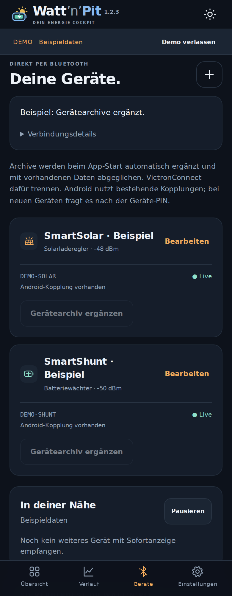

*Beispiel einer eingerichteten Anlage: Importstatus, vorhandene Android-Kopplung und manueller Archivabruf stehen auf der Geräteseite.*

- **Nur verwertbare Lücken nachladen:** Ein vollständiger Abrufplan je Gerät steht vor der ersten Messwertabfrage fest. Vorhandene einzelne Livepunkte reichen nicht aus, um eine Lücke als abgedeckt zu betrachten; erforderliche Archiv-Randpunkte bleiben nachladbar. Neu eintreffende Livewerte verkleinern ihn vor den folgenden Datenpaketen weiter. Jede App-Installation prüft ihre eigene lokale Datenbank vor dem Bluetooth-Abruf. Der Abgleich erfolgt getrennt nach Victron-Gerät, Messgröße und Auflösung. Vorhandene Live- und Archivwerte werden bereits vor der Übertragung übersprungen, auch wenn nur ein Teil eines früheren Datenpakets fehlt. Neue Werte und weiter zurückliegende Lücken werden gezielt angefordert. Ein anderes Handy kann deshalb einen anderen Nachladebedarf haben. Bereits bestätigte Messbereiche werden nicht pauschal erneut geladen. Veränderliche Antworten ohne Messwert können bei einem späteren Abgleich erneut geprüft werden.
- Der Live-Scan wird beim Archivabruf nicht mehr abgeschaltet. Wenn ein Gerät weiter Bluetooth-Livewerte sendet, werden sie aufgezeichnet und auch während des Imports angezeigt. Das gerade per Archivverbindung belegte Victron-Gerät kann seine Sofortanzeige zeitweise selbst aussetzen.
- Zeitreferenzen werden je Gerät lokal zwischengespeichert. Bekannte historische Referenzen werden beim nächsten Abruf übersprungen. Bereiche ohne sichere Zeitzuordnung werden bereits vor der Messwertübertragung zurückgestellt und nicht bei jedem Öffnen wieder vollständig gelesen. Neue passende Referenzen machen sie später wieder nachladbar.
- **Geschlossene Oberfläche bedeutet keine Aufzeichnungslücke:** Der gestartete Hintergrunddienst speichert empfangene Livewerte im gewählten Speicherintervall weiter. Zusammenhängende Zehn-Sekunden-Aufzeichnung wird beispielsweise auch gegenüber einem sekündlichen Gerätearchiv als vorhanden erkannt. Echte Empfangsausfälle bleiben offen. Ältere Aufzeichnungen ohne gespeichertes Intervall behalten ihre bisherige Zeitgrenze von 90 Sekunden; für neue Aufzeichnungen gilt das tatsächlich gespeicherte Intervall. Abgleich, Kurve und Energieberechnung verwenden dafür dieselbe Grundlage.
- Fehlende Zeiträume lassen sich nur in der vom Gerät vorgehaltenen Auflösung ergänzen. Das Livepaket enthält nicht jede Archivmessgröße: Beispielsweise kann die PV-Eingangsspannung zusätzlich fehlen. Neue Metadaten und Zeitanker sowie aktuelle Tages- und Shunt-Gesamtwerte werden weiterhin geprüft. Der Fortschritt bezieht sich auf die vorab ermittelten fehlenden Trendwerte und nennt bereits vorhandene, nicht geladene Werte.
- Abgeschlossene Solar-Tage werden nach einem Abruf als vergangener Tag behalten. Der aktuelle Tag wird weiter aktualisiert und nach dem Tageswechsel einmal vollständig übernommen. Beim Update werden ältere Tageswerte einmalig bestätigt; bestehende Messdaten und Einstellungen bleiben erhalten.
- Während des Imports erscheint auf jeder Seite **Synchronisation läuft**. Zunächst ist die übrige Oberfläche gedimmt und gesperrt. Über **Im Hintergrund synchronisieren** gibst du die Bedienung für diesen Durchlauf frei. Der Abruf läuft weiter; die Auswahl gilt auch für das nächste Gerät in derselben Warteschlange. Beim nächsten neuen Durchlauf erscheint die Warteanzeige wieder. Es gibt dafür keine dauerhafte Einstellung. Gerät und Arbeitsschritt werden genannt; bei bekanntem Umfang erscheint der tatsächliche Fortschritt für das aktuelle Gerät, ansonsten eine Aktivitätsanzeige. **Synchronisation abbrechen** bleibt erreichbar. Bereits abgeschlossene Datenblöcke bleiben nach einem Abbruch gespeichert. Der nächste Abruf erkennt diese Werte und ergänzt die verbleibenden Lücken. Bei einem späteren fälligen Abgleich werden verbleibende Lücken ergänzt; ein manueller Abruf ist jederzeit unter **Geräte → Gerätearchiv ergänzen** möglich, sobald der laufende Import beendet ist. Nach Erfolg, Abbruch oder Fehler wird die Bedienung automatisch wieder freigegeben. Offene Eingaben bleiben erhalten. Nach dem Wechsel in den Hintergrund zeigt die kompakte Leiste oben **Synchronisation läuft · Werte vorläufig**. Antippen öffnet Gerät, Fortschritt und Abbrechen erneut; **Weiter im Hintergrund** oder Android-Zurück schließt diese Fortschrittsansicht wieder. Beim erneuten Öffnen der App während desselben Abrufs bleibt die Wahl erhalten.
- Beim Update bleiben sämtliche Messwerte erhalten. Frühere Archiv-Abschlussmarker werden einmal neu geprüft, da bereits angeforderte Werte früher wegen naher Livepunkte verworfen werden konnten. Tatsächlich vorhandene zusammenhängende Daten werden weiter übersprungen. Archivwerte verschiedener Auflösungen am selben Zeitpunkt bleiben nun separat erhalten.
- Archivwerte und selbst aufgezeichnete Werte können unterschiedlich fein sein. Die Standardansicht führt die Quellen zusammen; feinere vorhandene Messwerte haben Vorrang.
- Leere Archivfelder werden nicht als gemessene Nullwerte ausgegeben. Lücken können deshalb sichtbar bleiben.

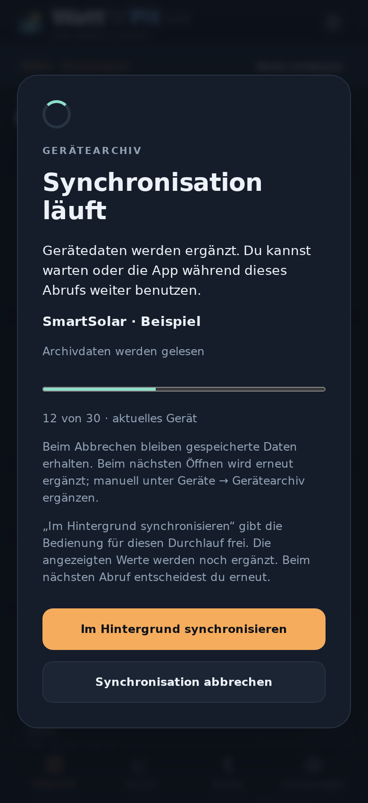

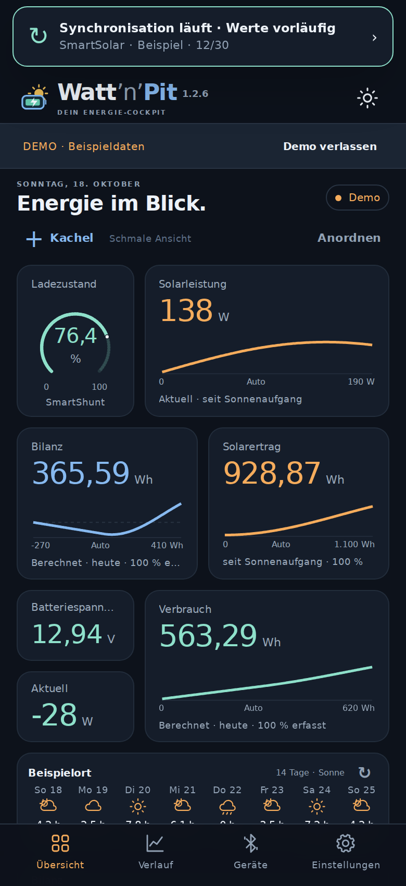

Währenddessen bleibt der letzte verfügbare Datenstand sichtbar. Neue Zeiträume und Vergleichswerte werden ohne Bedienungssperre im Hintergrund geladen; bis zur Antwort erscheint **Daten werden im Hintergrund geladen …**. Die Werte sind während des Imports vorläufig und werden nach dessen Ende gemeinsam aktualisiert.

Falls nichts ankommt: Bluetooth und Reichweite prüfen, VictronConnect vom Gerät trennen und den Import erneut versuchen. **Liveempfang** bestätigt den Empfang der Sofortanzeige; der aktive Archivabruf ist ein eigener Vorgang. Über **Verbindungsdetails → Diagnose kopieren** lässt sich ein Bericht ohne Geräteadressen, Schlüssel oder Messwerte kopieren.

## 3. Den Startbildschirm gestalten

| Dunkles Design | Helles Design |
|---|---|
| 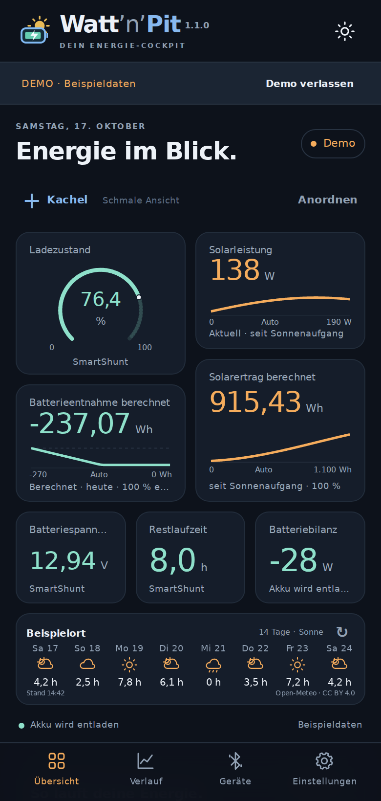 | 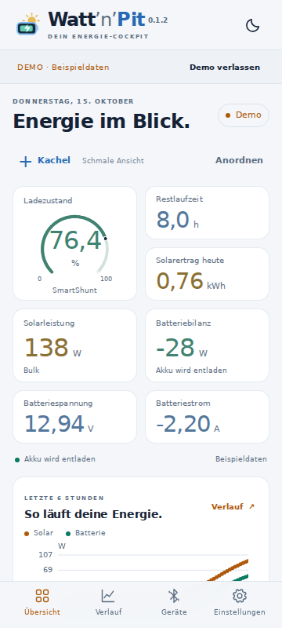 |

*Sieben Messkacheln und die kompakte Wetterkachel bilden den Standard. Werte, Farben, Größe und Position lassen sich anpassen.*

Auf schmalen Bildschirmen stehen der schmale Ladezustand und die breitere Solarleistung oben. Darunter folgen „Bilanz“ und Solarertrag nebeneinander. Batteriespannung und die mit „Aktuell“ beschriftete Batteriebilanz stehen links übereinander; rechts liegt der größere berechnete Verbrauch. Das Wetter liegt flach über die gesamte Breite. Anschließend folgen Verlauf und Start/Pause. Im Hochformat bleibt diese Anordnung erhalten. Im Querformat wechseln **+ Kachel**, **Anordnen**, Empfangszustand und Ansichtsart zusammen mit „Energie im Blick“ in den kompakten Appkopf. Ab 760 Pixel Breite stehen sie gemeinsam in einer Zeile.

Die Restlaufzeit kann über **+ Kachel → Akku → Restlaufzeit** ergänzt werden; Stunden sind weiterhin die voreingestellte Einheit.

Solarleistung und Solarertrag zeigen im Standard die Zeit **seit Sonnenaufgang**. Nach Sonnenuntergang endet ihre Zeitachse dort; der erreichte Wh-Ertrag bleibt sichtbar. Verwertbare Erzeugung davor oder danach erweitert das Fenster und wird mitgezählt. Die Aufzeichnung läuft weiter. Ohne gültigen Sonnenuntergang reicht das Solarfenster mit erkennbarem Hinweis bis jetzt. Verbrauch und Bilanz beziehen sich auf **heute ab Mitternacht** und enthalten damit auch die Nacht. Die vier Verlaufskacheln passen ihre Skalen automatisch an die vorhandenen Werte an. Die breite Ansicht besitzt eine eigene gespeicherte Anordnung.

**+ Kachel** öffnet die Auswahl. Neue Kacheln erscheinen am Ende des Rasters. Eine Messkachel antippen und **Kachel-Einstellungen** wählen, um Beschriftung, Einheit, Darstellung und Zeitraum dauerhaft zu ändern. **Großansicht öffnen** zeigt dieselbe Messgröße zum Untersuchen in groß. Als Darstellung stehen je nach Messgröße Zahl, Rundinstrument oder Verlauf zur Wahl.

Unter **Anordnen** die Kacheln ziehen und an der unteren rechten Ecke vergrößern. Das Raster für Position und Größe ist in beiden Formaten doppelt so fein wie zuvor. Überlappungen sind erlaubt. Andere Kacheln behalten ihre Position. **Fertig** beendet die Anordnung. Schmale und breite Ansichten speichern ihre Positionen und Größen getrennt. Auch die Höhe von **„So läuft deine Energie.“** ist verstellbar: Unter **Anordnen** den ↕-Griff unten rechts nach oben oder unten ziehen, anschließend **Fertig**. Die Höhe bleibt je Ansicht separat gespeichert und ist in der Einstellungssicherung enthalten. Mit Tastatur ändern ↑/↓ die Höhe in 20-Pixel-Schritten.

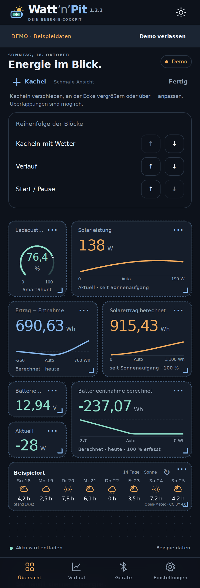

*Die Reihenfolge von „Kacheln mit Wetter“, „Verlauf“ und „Start / Pause“ lässt sich über die Pfeile ändern. Innerhalb des Kachelblocks wird direkt gezogen.*

**Einstellungen → Standardübersicht wiederherstellen** stellt die neue Standardansicht einschließlich der Kachelzeiträume für schmale und breite Bildschirme her. Beim normalen App-Update bleiben vorhandene eigene Übersichten erhalten. Messdaten und eingerichtete Geräte werden durch das Wiederherstellen der Standardübersicht nicht verändert.

Bei **„So läuft deine Energie.“** stehen **Seit Sonnenaufgang, Heute, Gestern, Woche, Monat, Letzte 6 Stunden und Letzte 24 Stunden** zur Wahl. Woche umfasst die letzten sieben Kalendertage einschließlich heute, Monat die letzten 30. Gestern zeigt den vollständigen vorherigen Tag; Zeitumstellungen werden berücksichtigt. Die Auswahl bleibt nach einem Neustart erhalten. Es werden vorhandene lokale Messwerte gelesen; fehlende Messzeiten bleiben Lücken.

## 4. Aktuell, Zeitraum und Skala wählen

Bei einer Verlaufskachel sind **die große Zahl und die Kurve getrennt einstellbar**:

| Einstellung | Bedeutung |
|---|---|
| Große Zahl: **Aktuell (Live)** | Frischer Empfang des Geräts; ohne frischen Wert erscheint „—“. |
| Große Zahl: **Letzter gespeicherter Wert** | Letzter gespeicherter Wert im gewählten Zeitraum. |
| Durchschnitt / Minimum / Maximum | Auswertung vorhandener Werte im gewählten Zeitraum. |
| Kurvenzeitraum: **Seit Sonnenaufgang** | Regulär Sonnenaufgang bis jetzt, nach Sonnenuntergang nur bis Sonnenuntergang; gemessene frühere oder spätere Erzeugung erweitert das Fenster. |
| Skala: **Automatisch nach bisherigen Werten** | Grenzen folgen den Messwerten des gewählten Zeitraums. |

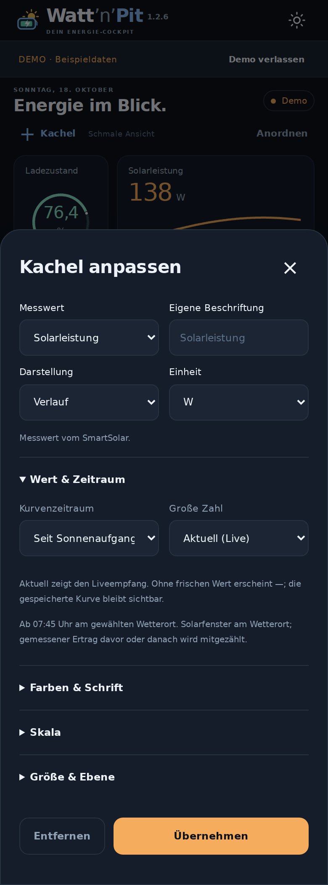

*Beispiel Solarleistung: Livezahl anzeigen und die gespeicherte Kurve seit Sonnenaufgang betrachten. Die Skala kann sich automatisch anpassen.*

**Kachel antippen → Kachel-Einstellungen → Wert & Zeitraum → Seit Sonnenaufgang** funktioniert auch bei berechnetem Solarertrag und Batterieentnahme. Deren Energiesummen beziehen sich dann auf dieses Fenster. Ohne verwendbare Sonnenaufgangszeit oder vor dem heutigen Sonnenaufgang steht ausdrücklich **heute (Ersatz)**; die Auswahl bleibt gespeichert.

Unter **Skala** zwischen festen Grenzen und automatischer Skalierung wählen. Bei kleinen Solarleistungen nutzt die Kurve dadurch die verfügbare Höhe. Spannungs- und Temperaturkurven passen auch die Untergrenze an. **Farben & Schrift** bietet eigene Farben, Schriftgröße, Nachkommastellen, Hintergrund und Deckkraft.

### Großansicht und Vergleichswerte

**Kachel antippen → Großansicht öffnen** vergrößert die Messgröße. Oben den Zeitraum wählen: Heute, Gestern, Woche, Monat, Seit Sonnenaufgang, Seit Zurücksetzen, Letzte … oder Von / bis. **Ansicht einstellen** öffnet Darstellung, Einheit, große Zahl, automatische oder feste Skalen, Nachkommastellen und Farbe.

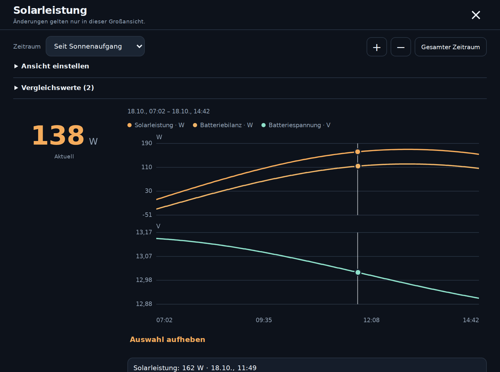

Unter **Vergleichswerte** weitere Messgrößen einschalten. Gleiche Einheiten werden gemeinsam dargestellt; unterschiedliche Einheiten erhalten eigene Werteskalen bei derselben Zeitachse. **+ / −** zoomt die Zeitachse. Einen Messpunkt antippen oder kurz gedrückt halten: Ein farbiger **Punkt** auf der Kurve und eine **senkrechte Linie** zeigen die Auswahl. Die Auswahl mit einem Finger ziehen; Markierung, Uhrzeit und Messwerte folgen. Bei Vergleichskurven erscheinen Punkte nur an tatsächlich vorhandenen nahen Messwerten; in Messlücken wird kein Wert erfunden. **Auswahl aufheben** beendet die Auswahl. Danach verschiebt ein Finger wieder den Zeitraum; zwei Finger zoomen auch während einer Auswahl. **Gesamter Zeitraum** stellt das vollständige gewählte Zeitfenster wieder her. Berechnete Energiesummen bleiben auf den gewählten Zeitraum bezogen.

Diese Änderungen gelten nur in der geöffneten Großansicht. **×** oder Android-Zurück schließt sie; die gespeicherte Kachel und ihre Anordnung bleiben erhalten. Für bleibende Änderungen **Kachel-Einstellungen** verwenden. Im Anordnungsmodus öffnet Antippen direkt den Kacheleditor.

## 5. Solarertrag, Verbrauch und Bilanz verstehen

| Kachel | Bedeutung | Standardzeitraum |
|---|---|---|
| **Solarertrag** | Aus der gemessenen Solarleistung berechnete Energie | Seit Sonnenaufgang |
| **Verbrauch** | Solarertrag minus Akkubilanz; direkt genutzter Solarstrom ist enthalten | Heute ab Mitternacht |
| **Bilanz** | Solarertrag minus berechneter Verbrauch | Heute ab Mitternacht |

Beispiel: **100 Wh Solarertrag − 150 Wh Verbrauch = −50 Wh Bilanz**. Plus bedeutet Überschuss, Minus Defizit. Wh und kWh sind wählbar. Die Rechnung verwendet die tatsächlichen Zeitabstände der erfassten Leistungspunkte und ist eine Näherung aus Regler und Shunt einschließlich der Verluste zwischen den Messstellen.

Der nächtliche Verbrauch bleibt enthalten: Außerhalb des Solarfensters zählt der beobachtete Shunt-Verlauf mit Solar null. Tatsächlich erfasste frühe oder späte Erzeugung erweitert das Fenster und wird in Ertrag und Verbrauch mitgeführt. Innerhalb dieses Fensters werden nur Zeitabschnitte verwendet, in denen Solarregler **und** Shunt verwertbare Daten haben. Es werden keine unbekannten Tageslücken mit null aufgefüllt. Die Prozentangabe nennt die erfasste Zeit des jeweiligen Fensters; fehlende Messintervalle erscheinen als **—**, erfasste Null als **0,00**. Ohne gültige Sonnenaufgangszeit wird ausdrücklich **heute (Ersatz)** verwendet. Vor dem bekannten Sonnenaufgang steht der Ertrag ohne verwertbare frühere Erzeugung bei 0 Wh. Verbrauch und Bilanz zählen auch nach Sonnenuntergang weiter; die Differenz bleibt Ertrag minus Verbrauch.

Unter **Verlauf → Energie berechnet** erscheinen diese drei Kurven für die dortige Zeit- und Quellenwahl. **Kurve „Bilanz“ anzeigen** blendet die dritte Kurve ein oder aus. Antippen des Diagramms zeigt die Werte am ausgewählten Zeitpunkt. Überlappende Aufzeichnungen, Archive und CSV-Werte werden einmal gezählt; eigene Aufzeichnungen und feinere Archive haben Vorrang. Die Bilanz beschreibt den Energiefluss und keine genaue Änderung der chemisch gespeicherten Akkuenergie; Ladeverluste werden nicht korrigiert.

### Zusätzlicher PWM-Regler und andere Einspeisungen

Ein Regler ohne eigenen Ertragsmesswert entlastet den Akku, fehlt aber im angezeigten Solarertrag. Dadurch fällt auch der **berechnete Verbrauch um diesen Ertrag zu niedrig aus**.

Beispiel: Der SmartSolar liefert **20 Wh**, ein ungemessener PWM-Regler **30 Wh**, die Verbraucher nutzen tatsächlich **100 Wh**. Die App zeigt **20 Wh Solarertrag, 70 Wh Verbrauch und −50 Wh Bilanz**. Im reinen Solarbetrieb bleibt die Differenz richtig, obwohl Ertrag und Verbrauch unvollständig sind. Das setzt voraus, dass die Batteriezweige korrekt über den Shunt erfasst werden.

Ungemessener Landstrom oder andere Ladegeräte beeinflussen den Rechenwert ebenfalls. Bei starker zusätzlicher Einspeisung kann er negativ werden. Die Verbrauchskachel meldet dann **Zusätzliche Einspeisung**; der Wert wird nicht auf null begrenzt. Der Hinweis steht auch in den Kacheleinstellungen, in der Großansicht und unter **Verlauf → Energie berechnet → Berechnung und zusätzliche Einspeisung**.

### Die drei Kacheln einstellen

Die vorhandene Batterieentnahme-Kachel wird beim Update zu **Verbrauch**, die bisherige Akkubilanz zu **Bilanz**. Position, Größe in beiden Ansichten, Farben, Einheiten und eigene Beschriftungen bleiben erhalten. Unveränderte alte Standardbeschriftungen werden aktualisiert. Der Tagesstandard ist Solarertrag ab Sonnenaufgang und Verbrauch/Bilanz ab Mitternacht.

Unter **+ Kachel → Energie** sind alle drei Werte einzeln ergänzbar. **Kachel antippen → Kachel-Einstellungen** bietet Zahlenwert, Rundinstrument oder Verlauf sowie Wh/kWh, Farben und Skala. Verbrauch und Bilanz verwenden einen gemeinsamen Zeitraum. Bei **Heute** kann Solar seit Sonnenaufgang zählen; bei **Letzte …**, **Seit Zurücksetzen** und freien Zeiträumen wechseln die drei Werte gemeinsam. Eine dauerhaft geänderte Sonnenaufgangsauswahl an der Solarkachel lässt Verbrauch und Bilanz auf Heute stehen. Vorzeichen der drei Hauptwerte bleiben ihrer Bedeutung entsprechend; in der Großansicht gelten Änderungen weiterhin nur vorübergehend.

Die bisherigen Werte **Batterieentnahme berechnet** und **Akkubilanz** bleiben unter **+ Kachel → Energie** als unabhängige Zusatzwerte verfügbar. Batterieentnahme summiert nur Energie aus dem Akku und erscheint standardmäßig negativ; die Akkubilanz summiert Laden minus Entladen allein aus dem Shunt. Deren Vorzeichen lassen sich weiterhin umkehren. Der grobe Tageszähler des SmartSolar bleibt unter **Solarertrag heute** auswählbar.

Alle Einstellungen einschließlich beider Anordnungen und des gemeinsamen Vergleichszeitraums sind in der JSON-Einstellungssicherung enthalten.

## 6. Den Verlauf untersuchen

Unter **Verlauf** den Zeitraum und die Messgröße wählen. **Alle Daten**, **Aufgezeichnet**, **Gerätearchiv** und **CSV-Import** filtern die Datenquelle.

*Solarleistung und Batteriebilanz gemeinsam betrachten. Unter „Werteskala“ lassen sich die Grenzen von Hand setzen.*

Mit **+ / −** die Zeitachse zoomen. Mit einem Finger die Zeitachse verschieben, mit zwei Fingern zoomen und durch Antippen einzelne Werte ansehen. Lange Zeiträume bündeln Messwerte; die Schattierung zeigt die ursprünglichen Minima und Maxima. **Zurücksetzen** stellt die Achsen zurück.

Die kleine Verlaufskarte auf der Übersicht bietet **Seit Sonnenaufgang**, **Heute**, **Gestern**, **Woche**, **Monat**, **Letzte 6 Stunden** und **Letzte 24 Stunden**. Diese Auswahl ist unabhängig vom großen Verlauf und den einzelnen Kacheln.

Im **Solar-Tagesarchiv** unter dem Verlauf steht neben dem importierten Ertrag der **berechnete Verbrauch in Wh**. Er gilt für den lokalen Kalendertag einschließlich der Nacht und verwendet die vorhandenen Solar- und Shunt-Messungen. Die Prozentangabe zeigt die zeitliche Abdeckung; Lücken werden nicht hochgerechnet. „—“ bedeutet, dass keine verwertbaren Messabschnitte vorhanden sind, und ist von einem gemessenen Nullverbrauch zu unterscheiden. Der heutige Wert ist vorläufig. Der Regler-Tagesertrag und der berechnete Verbrauch können wegen unterschiedlicher Datenquellen und Abdeckung nicht unmittelbar zu einer Bilanz subtrahiert werden. Die weiteren Tabellenspalten bleiben seitlich erreichbar.

## 7. Wetter und Solaranlage einstellen

**Einstellungen → Sonne voraus.** öffnet die manuelle Ortssuche. GPS wird dafür nicht benötigt. Nach der Ortswahl zeigt die flache Wetterkachel **14 Tage mit je einem Symbol und den erwarteten Sonnenstunden**. Seitlich wischen, um die weiteren Tage zu sehen; **↻** aktualisiert die Vorschau von Hand.

**Ab 1.2.2 wird die Vorhersage beim Öffnen der App und bei der Rückkehr aus dem Hintergrund automatisch frisch geladen**, sofern ein Wetterort eingestellt ist. Der Abruf läuft im Hintergrund. Währenddessen und ohne Internet bleibt die gespeicherte Vorschau sichtbar; bei einem Fehler erscheint ein entsprechender Hinweis. Ohne aktivierten Wetterort erfolgt kein Wetterabruf. **Wetter ausschalten** deaktiviert die Wetterfunktion wieder.

Die Wetterkachel liegt im selben Raster wie die Messkacheln. **Anordnen** macht sie verschiebbar. Den Ortskopf antippen oder **···** wählen, um Beschriftung, Breite, Höhe und Deckkraft anzupassen. Nach dem Entfernen ist sie über **+ Kachel → Wetter** wieder verfügbar. Ohne Wetterort wird sie außerhalb des Anordnungsmodus ausgeblendet.

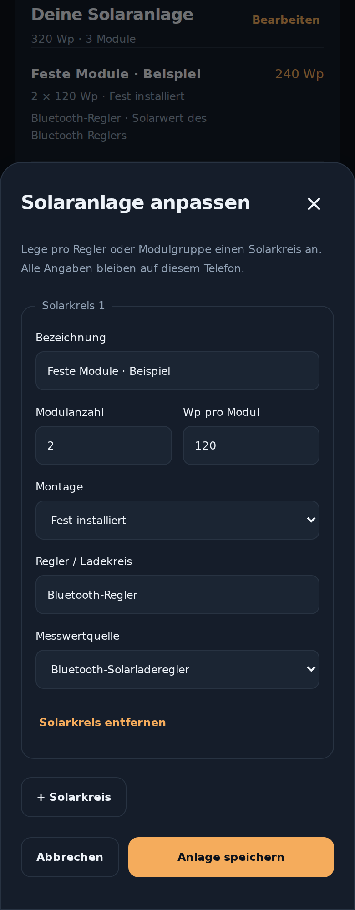

*Einstellungen → Deine Solaranlage → Bearbeiten: Modulgruppen beschreiben und ihre Messwertquelle zuordnen. Die gezeigten Angaben sind frei erfunden.*

Pro Solarkreis lassen sich Bezeichnung, Modulanzahl, Wp pro Modul, Montage und Regler eintragen. Als Messwertquelle stehen Bluetooth-Solarladeregler, Batteriebilanz des Shunts oder kein eigener Messwert zur Wahl. Die Nennleistung beschreibt deine Hardware; sie ersetzt keine Messung und ändert keine Geräteparameter. In 1.3.10 kann je ein SmartSolar und ein SmartShunt eingerichtet werden.

## 8. Einstellungen und Messdaten sichern

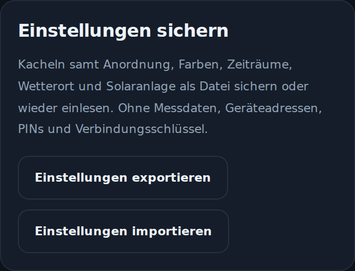

*Einstellungen → Einstellungen sichern: die persönliche Gestaltung und Anlagenkonfiguration als Datei sichern.*

**Einstellungen exportieren** erstellt eine JSON-Datei mit Kacheln, beiden Anordnungen, Farben, Zeiträumen, Akku-/Speicherparametern, Solaranlage und Wetterort. **Einstellungen importieren** zeigt vor der Übernahme eine geprüfte Vorschau. Ältere Sicherungen mit separatem Wetterblock werden übernommen.

Die Einstellungssicherung enthält **keine Geräteadressen, PINs, Verbindungsschlüssel oder Messdaten**. Auf dem Zieltelefon eingerichtete Geräte und vorhandene Messdaten bleiben erhalten. Auf einem neuen Telefon die Geräte separat einrichten. Der enthaltene Wetterort gehört zu deiner Konfiguration; eine Sicherung deshalb bewusst weitergeben.

Messdaten werden getrennt über **Verlauf → Verlauf exportieren** als CSV gesichert und über **CSV importieren** wieder eingelesen. Näheres zur Spaltenzuordnung: [CSV-Import und Datenexport](CSV-IMPORT.md).

## 9. Lokal, mit optionalem Wetterabruf

Watt’n’Pit benötigt kein Konto und überträgt keine Energiedaten oder Geräteschlüssel an einen Cloud-Dienst. Schlüssel liegen mit dem Android Keystore geschützt auf dem Telefon. Die optionale Wetterfunktion benötigt Internet: Suchtext bzw. gewählte Ortskoordinaten gehen an Open-Meteo. Wetterdaten: Open-Meteo, CC BY 4.0; Ortsdaten: GeoNames.

Ladezustand und Restlaufzeit stammen vom SmartShunt. Temperatur und Zusatzspannung benötigen einen entsprechend eingerichteten Eingang. Weitere Victron-Geräte sind nicht pauschal als kompatibel bestätigt. [Technische Grundlage und Grenzen](ARCHITECTURE.md).
